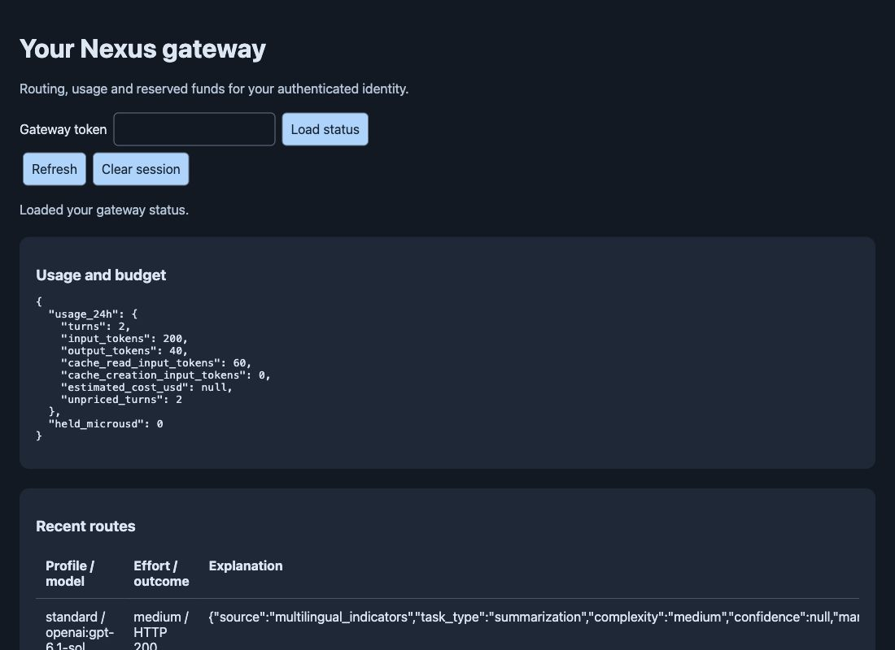

# Gateway browser verification

Date: 2026-11-13. Tested the source gateway dashboard in the ChatGPT in-app
browser against an isolated loopback server and temporary SQLite database.
The server was stopped after testing. No user settings were changed.

Two synthetic successful routes supplied usage, model choices and routing
explanations. No upstream inference was requested.

Verified interactions:

- Entering the preview token loaded caller status and both routes.
- Report poor result returned “Feedback recorded; no work was replayed.”
- Request stronger route returned a level-one ticket for the deep profile.
- Clear session removed usage, route rows, reservations and ticket details.
- Refresh after clearing returned “Enter a gateway token.”
- No browser console errors were captured.

The rebuilt 0.2.0 wheel was also installed into an isolated target directory.
An HTTP fixture verified routing through its embedded Vertex policy and schema,
cache-control preservation, cache-token accounting, and absence of heavyweight
optional classifier imports. This verifies package behavior against a fixture;
it does not establish live Vertex authentication or provider cache hits.

Live Cowork/Vertex inference, Codex client attachment, Antigravity client
attachment, and Docker runtime validation remain subject to the separate host
and credential limitations documented in [client gateways](../client-gateways.md).
